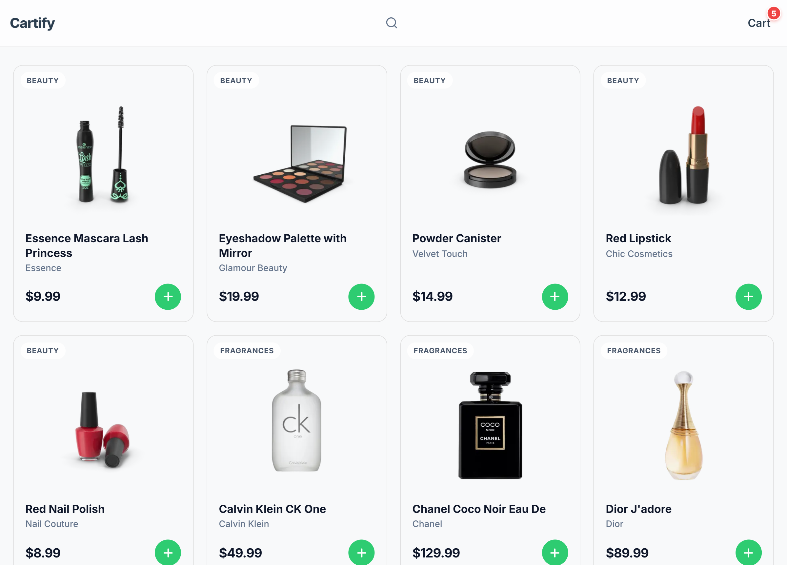
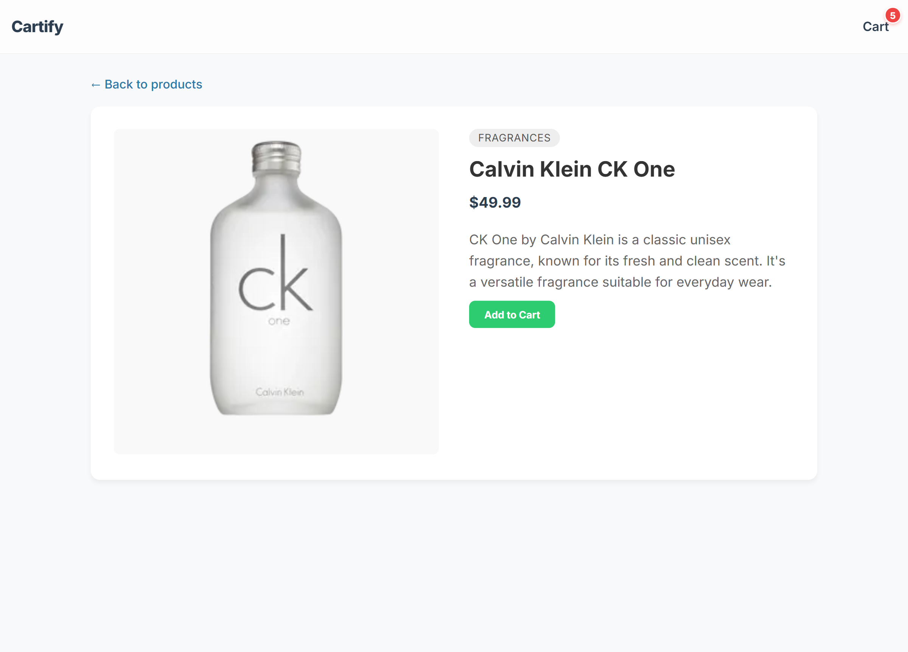
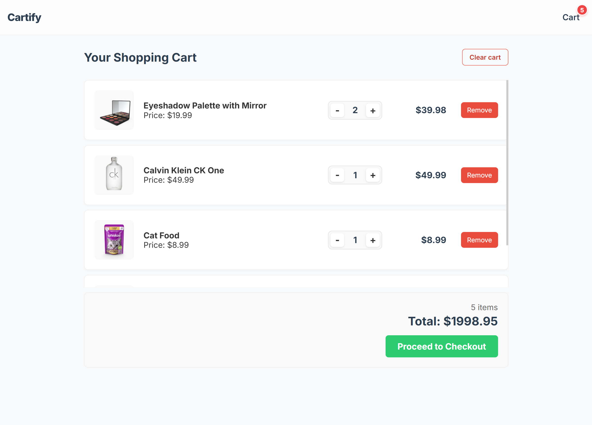

# Cartify

A demo online store built with Vue 3. Browse and search products, open a product page, manage a cart that survives page refreshes, and go through a simulated checkout.

**Live demo:** https://smah-ir.github.io/cartify/

## Screenshots





## Features

- Product grid with live search and a loading skeleton
- Loads products from the DummyJSON API (4-second timeout) and falls back to a local snapshot if the API is unavailable
- Clear loading, error (with a "Try again" button) and empty states
- Product page on a dynamic route, plus a 404 page
- Cart with quantity controls (max 99 per product), totals and a navbar badge
- "Clear cart" with confirmation, and "Undo" after removing items or clearing the cart
- Cart saved in `localStorage`, with safe handling of corrupted data
- Simulated checkout in an accessible modal dialog (labels, focus trap, Esc to close, scroll lock)
- Toast notifications, page transitions and list animations
- Responsive layout from mobile to desktop
- Unit tests for the cart store

## Tech Stack

Vue 3 (Composition API, `<script setup>`), Pinia, Vue Router, Vite, Vitest, plain CSS. Deployed with GitHub Actions to GitHub Pages.

## Run locally

```sh
npm install
npm run dev
```

Run the tests:

```sh
npm test
```

Build for production:

```sh
npm run build
npm run preview
```

## Project structure

```
src/
  components/   Toast
  router/       routes and page titles
  stores/       products, cart (+ tests), toast (Pinia)
  views/        Home, ProductDetail, Cart, NotFound
public/
  products.json local product snapshot (fallback data)
  images/       product thumbnails
scripts/
  download-products.mjs   regenerates the local snapshot from DummyJSON
```

## What I learned

- Structuring state with Pinia stores (state, getters, actions) and persisting it safely
- Dynamic routes, a 404 route and why hash history is needed on a static host
- The loading / error / data pattern, and handling a slow or blocked external API with a timeout (`AbortController`) and a local fallback
- Writing unit tests for a store with Vitest (including a mocked `localStorage`)
- Accessible markup: no button inside a link, labelled form fields, a dialog with focus trap and focus return
- Deploying a Vite app to GitHub Pages with the correct `base` path and a CI workflow

## Future improvements

- Category filter and price sorting
- TypeScript migration
- A real backend for orders

## Credits

Product data and images come from [DummyJSON](https://dummyjson.com/).
